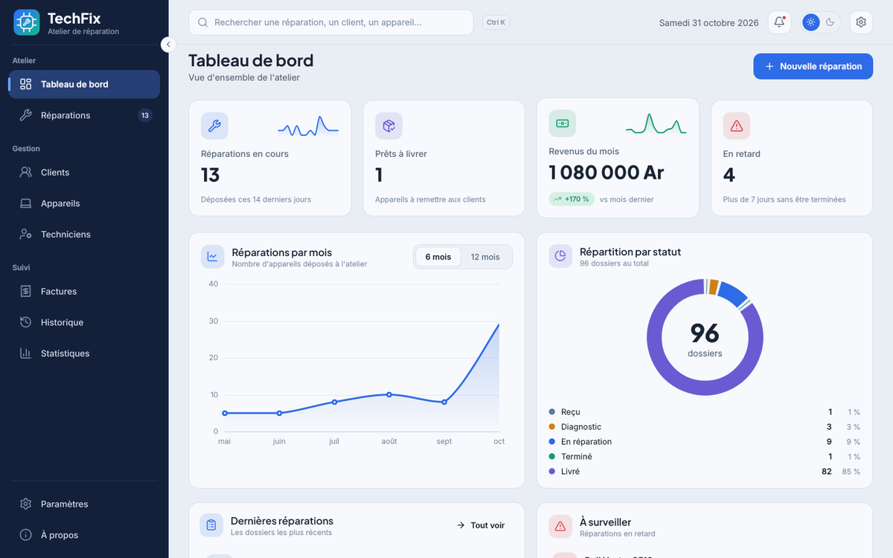
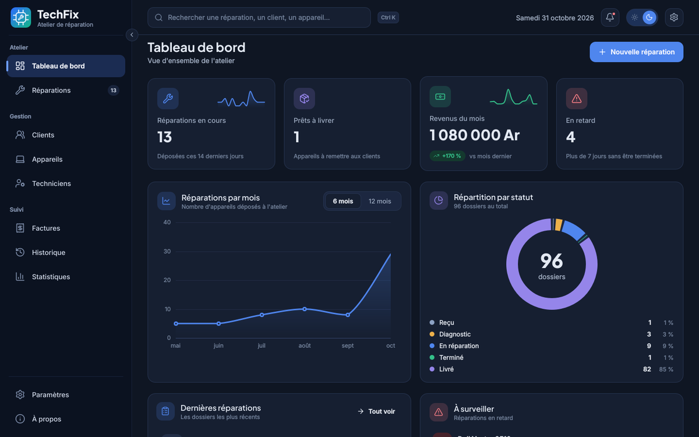
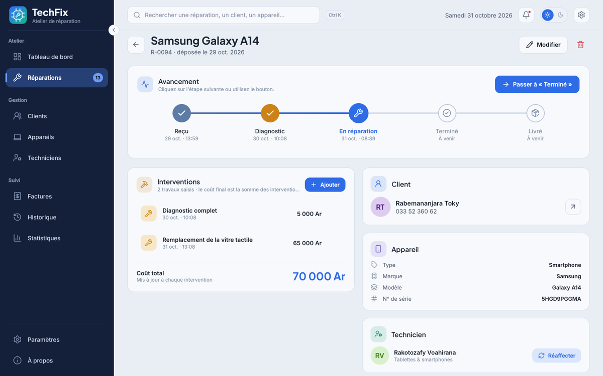
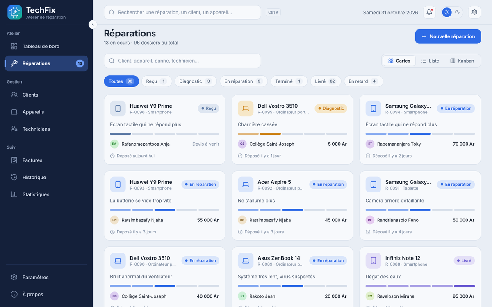
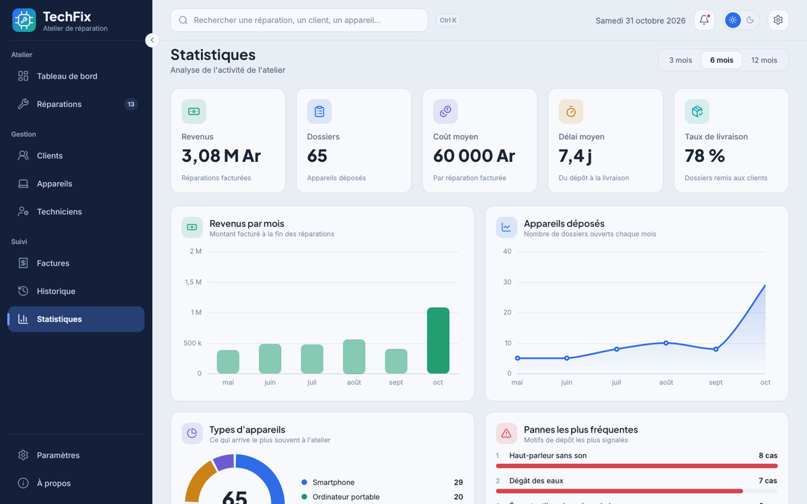

# TechFix

**Application de bureau pour gérer un atelier de réparation informatique** : dépôt des appareils, suivi des réparations étape par étape, affectation des techniciens et calcul automatique des coûts.

Construite avec **Qt Quick (QML)**, Qt 6.8 et CMake. Projet 4 de L1, réalisé en groupe.

> **État actuel : interface terminée, backend à venir.**
> L'application fonctionne entièrement avec des données fictives gardées en mémoire (rien n'est enregistré à la fermeture). La base de données sera branchée plus tard sans modifier les pages.



<table>
  <tr>
    <td></td>
    <td></td>
  </tr>
  <tr>
    <td></td>
    <td></td>
  </tr>
</table>

## Fonctionnalités

- **Clients et appareils** : enregistrement, modification, suppression ; chaque appareil appartient à un client (type, marque, modèle, numéro de série).
- **Réparations** : dépôt d'un appareil avec sa panne et sa date, affectation d'un technicien (réaffectable en un clic), vues en cartes, en liste ou en kanban, recherche et filtres par statut.
- **Frise des étapes** : *Reçu → Diagnostic → En réparation → Terminé → Livré*, étape par étape, sans saut ni retour en arrière.
- **Interventions et coûts** : chaque intervention a une description et un coût (5 000 Ar minimum) ; le coût final de la réparation est la somme de ses interventions, calculé automatiquement.
- **Techniciens** : charge de travail et réparations en cours.
- **Factures** : générées dès qu'une réparation est terminée.
- **Tableau de bord, statistiques et historique** : indicateurs, graphiques (dessinés en QML pur), réparations en retard, journal des événements.
- **Confort** : thème clair et sombre, interface adaptée à la taille de la fenêtre, recherche globale (`Ctrl+K`), notifications, animations, formulaires en panneau latéral.

## Règles métier appliquées

- Une réparation suit les étapes dans l'ordre : pas de saut, pas de retour en arrière.
- Le coût final = somme des coûts des interventions (jamais saisi à la main).
- Pour terminer une réparation, il faut au moins une intervention.
- Les interventions ne se saisissent qu'aux étapes *Diagnostic* et *En réparation* ; une fois terminée, elles sont figées.
- Une réparation terminée ou livrée est facturée : elle ne peut plus être supprimée.
- Un client ne peut pas être supprimé s'il a des appareils ; un appareil non plus s'il a des réparations.

## Démarrer

**Prérequis** : Qt 6.8 ou plus récent (kit *MinGW 64-bit* sous Windows), CMake 3.21+. Aucun module Qt supplémentaire : seuls *Qt Quick* et *Qt Quick Controls 2* sont utilisés. L'application fonctionne hors ligne.

1. Cloner le dépôt.
2. Qt Creator → *Fichier > Ouvrir un fichier ou un projet…* → choisir `CMakeLists.txt`.
3. Sélectionner le kit puis *Configurer le projet*.
4. `Ctrl+R` pour lancer.

La première compilation est la plus longue (Qt compile chaque fichier QML) ; les suivantes sont beaucoup plus rapides.

## Organisation du dossier

```
TechFix/
├── CMakeLists.txt          Module QML « TechFix », fichiers et ressources
├── .gitignore
├── README.md
├── src/
│   └── main.cpp            Seul fichier C++ : démarre Qt, charge polices, style Basic et Main.qml
├── assets/
│   ├── fonts/              Inter (texte) et Plus Jakarta Sans (titres), licences incluses
│   ├── logo/               Logo TechFix (SVG + PNG)
│   ├── icons/              Licence de la police d'icônes Lucide
│   └── windows/            Icône .ico de l'exécutable
├── docs/screenshots/       Captures utilisées dans ce README
└── qml/
    ├── Main.qml            Fenêtre : menu latéral + barre du haut + page courante
    ├── theme/              Theme (couleurs clair/sombre, polices), UI (navigation, toasts),
    │                       Fmt (dates, Ariary), Icons (police d'icônes)
    ├── data/               AppData (données en mémoire + règles métier), Forms (formulaires),
    │                       DemoData.js (génère les fausses données)
    ├── components/         Briques réutilisables : boutons, cartes, badges, champs, frise…
    ├── charts/             Graphiques en QML pur : courbe, barres, anneau, mini-courbe
    ├── layout/             Menu latéral, barre du haut, recherche globale, notifications
    └── pages/              Une page = un fichier : Dashboard, Repairs, RepairDetail, Clients,
                            Devices, Technicians, Invoices, Stats, History, Settings, About
```

**Principe** : les pages ne contiennent que de l'affichage. Elles lisent et modifient les données uniquement via `AppData`, et passent par `UI` pour naviguer ou afficher une notification.

## Brancher la base de données

Les données fictives sont isolées dans **un seul fichier** (`qml/data/DemoData.js`) et chargées à **un seul endroit** : la fonction `load()` de `qml/data/AppData.qml`.

- **Tester sans aucune donnée** (états vides) : passer `demoMode` à `false` dans `AppData.qml`.
- **Retirer définitivement les données fictives** :
  1. supprimer `qml/data/DemoData.js` et sa ligne dans `CMakeLists.txt` ;
  2. dans `AppData.qml`, retirer les 3 lignes marquées `// DEMO` ;
  3. dans `load()`, remplacer les listes vides par le résultat des requêtes SQL.

## Raccourcis

`Ctrl+K` recherche globale · `Alt+←` retour · bascule clair/sombre dans la barre du haut.

## Équipe

| | Rôle |
|---|---|
| **Nilaina** et **Voary** | Frontend (interface Qt Quick / QML) |
| **Annicha** et **Diary** | Backend (base de données) |

## Licences

- Polices **Inter** et **Plus Jakarta Sans** : SIL Open Font License 1.1.
- Icônes **Lucide** : licence ISC.

MIT
